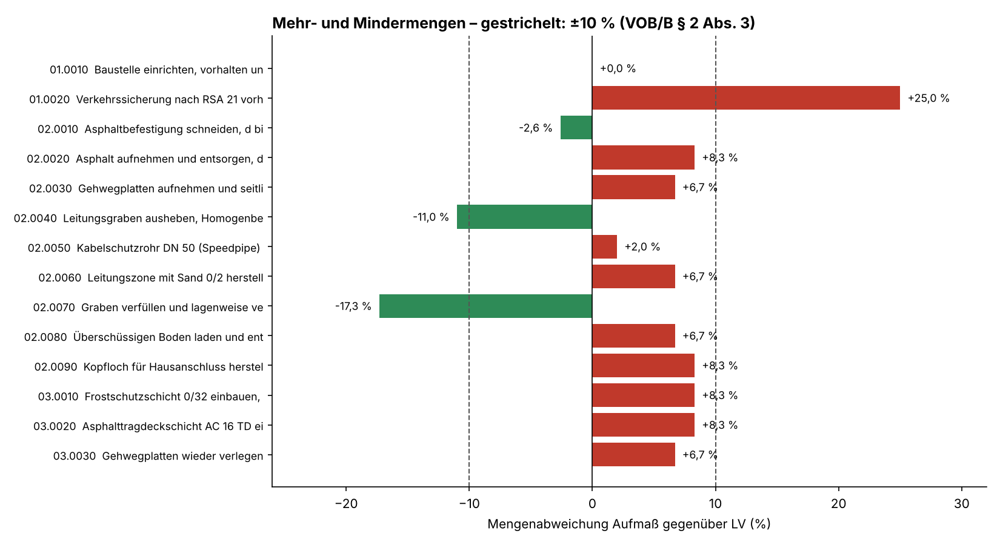
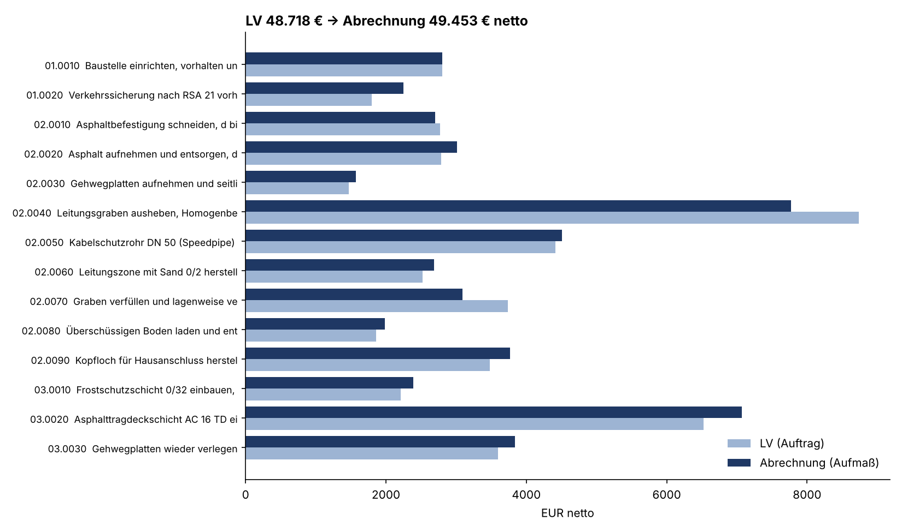
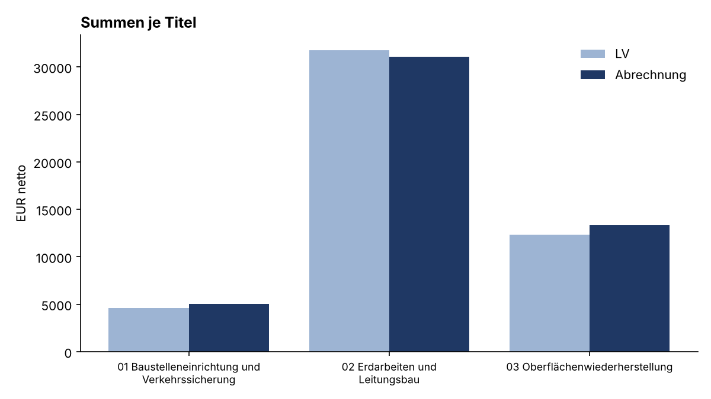
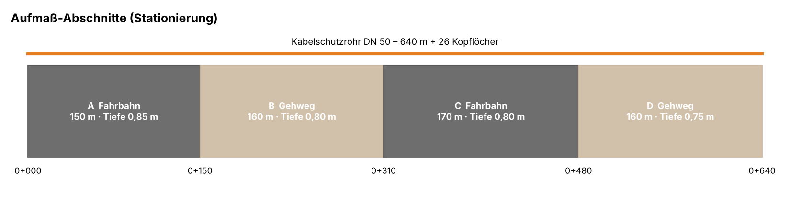

# Construction Billing – Quantity Survey, Billing and GAEB X31 (Fibre Civil Works)

[English](#construction-billing--quantity-survey-billing-and-gaeb-x31-fibre-civil-works) | [Deutsch](#deutsch)

How much can be invoiced after the works are finished? This project shows the full **construction billing workflow (Bauabrechnung)** for a **640 m fibre-optic civil works project** in a street: **bill of quantities (LV)** → **quantity survey (Aufmaß)** following the principle of **REB-VB 23.003** → **billing against the bill of quantities** with **over and under quantities** → **GAEB X31 export**, Excel tables and a short **report** – the typical tasks of a billing engineer (Bauabrechner) in civil engineering.



---

## Key results

| | |
|---|---|
| Project | Fictitious example: fibre-optic civil works, 640 m trench, road and footway |
| Bill of quantities | **14 items** in 3 sections (site setup, earthworks and duct laying, surfaces) |
| Contract sum (LV, net) | **48,718.00 €** |
| Billing sum (quantity survey, net) | **49,452.62 €** (58,848.62 € incl. 19 % VAT) |
| Difference | **+734.62 € (+1.5 %)** |
| Over / under quantities | **10** items over, **3** items under |
| Items with more than ±10 % | **3** – 01.0020 traffic safety (+25.0 %), 02.0040 excavation (−11.0 %), 02.0070 backfilling (−17.3 %) |

**Interpretation:** the billing sum is only 1.5 % above the contract sum, but three items differ by more than 10 %. Traffic safety took one week longer, excavation and backfilling are lower because the trench in the footway was shallower and the bedding zone is deducted from the backfill volume, and the asphalt area is larger because the cutting width was 0.65 m instead of 0.60 m. **Recommended measures:** check the items above ±10 % for a new unit price (VOB/B § 2 (3)), document the extra quantities (survey sheets, photos, site diary), agree the quantity survey with the client before the final invoice and hand over the quantities as GAEB X31.

| | |
|---|---|
|  |  |



---

## Workflow

| Step | Content |
|---|---|
| **1 Bill of quantities (LV)** | 14 items with item number (OZ), short text, quantity, unit and unit price (EP); total price (GP) = quantity × EP |
| **2 Quantity survey (Aufmaß)** | Route split into 4 sections (A/C road, B/D footway) with chainage; every line = number × length × width × height; deductions with negative number (REB-VB 23.003 principle) |
| **3 Billing** | Surveyed quantity × unit price per item; difference to the LV in quantity, € and %; items above ±10 % marked (VOB/B § 2 (3)) |
| **4 Export** | Excel workbook (key figures, LV, Aufmaß, billing, section sums), CSV files, GAEB DA XML 3.3 – DA 31 (X31, quantity determination), charts and a 3-page report in German |

## Limitations

- Fictitious example: quantities, dimensions and prices are assumptions, not real project data
- The GAEB X31 file uses a simplified structure of GAEB DA XML 3.3 (DA 31) and is not validated against the official XSD schema
- The REB-VB 23.003 is applied as a principle (number × length × width × height with deductions), not as a certified REB program

---

## Repository structure

```
Construction-Billing-Quantity-Survey-GAEB/
├── notebooks/
│   └── bauabrechnung_glasfaser_tiefbau.ipynb
├── images/
│   ├── 01_LV_vs_Abrechnung.png
│   ├── 02_Mehr_Mindermengen.png
│   ├── 03_Titelsummen.png
│   └── 04_Aufmass_Abschnitte.png
├── results/
│   ├── Bauabrechnung_Glasfaser_Tiefbau_Bericht.pdf   # report (German)
│   ├── bauabrechnung_glasfaser_tiefbau.xlsx          # all tables
│   ├── aufmass_glasfaser_tiefbau.X31                 # GAEB X31 (quantity determination)
│   ├── lv.csv
│   ├── aufmass.csv
│   ├── abrechnung.csv
│   └── kennzahlen.csv
├── requirements.txt
├── LICENSE
└── README.md
```

The notebook runs in Google Colab or locally; all input data are defined in the notebook, no download is needed.

## Tools

Python · pandas · openpyxl · Matplotlib · GAEB DA XML · Excel · Google Colab

## Data sources

Fictitious example project created for this portfolio. No real project or client data.

## License

Code: MIT License – see [LICENSE](LICENSE)

---
---

# Deutsch

[English](#construction-billing--quantity-survey-billing-and-gaeb-x31-fibre-civil-works) | [Deutsch](#deutsch)

Wie viel kann nach der Ausführung abgerechnet werden? Dieses Projekt zeigt den vollständigen **Ablauf der Bauabrechnung** für **640 m Glasfaser-Tiefbau** in einer Straße: **Leistungsverzeichnis (LV)** → **Aufmaß** nach dem Prinzip der **REB-VB 23.003** → **Abrechnung gegen das LV** mit **Mehr- und Mindermengen** → **GAEB-X31-Export**, Excel-Tabellen und ein kurzer **Bericht** – die typischen Aufgaben eines Bauabrechners im Tiefbau.


---

## Zentrale Ergebnisse

| | |
|---|---|
| Projekt | Fiktives Beispiel: Glasfaser-Tiefbau, 640 m Graben, Fahrbahn und Gehweg |
| Leistungsverzeichnis | **14 Positionen** in 3 Titeln (Baustelleneinrichtung, Erdarbeiten und Leitungsbau, Oberflächen) |
| Auftragssumme (LV, netto) | **48.718,00 €** |
| Abrechnungssumme (Aufmaß, netto) | **49.452,62 €** (58.848,62 € inkl. 19 % MwSt) |
| Differenz | **+734,62 € (+1,5 %)** |
| Mehr- / Mindermengen | **10** Positionen mit Mehrmenge, **3** mit Mindermenge |
| Positionen über ±10 % | **3** – 01.0020 Verkehrssicherung (+25,0 %), 02.0040 Aushub (−11,0 %), 02.0070 Verfüllen (−17,3 %) |

**Interpretation:** Die Abrechnungssumme liegt nur 1,5 % über der Auftragssumme, aber drei Positionen weichen um mehr als 10 % ab. Die Verkehrssicherung dauerte eine Woche länger, Aushub und Verfüllen sind geringer, weil der Graben im Gehweg flacher ausgeführt wurde und die Leitungszone vom Verfüllvolumen abgezogen wird, und die Asphaltfläche ist größer, weil die Aufbruchbreite 0,65 m statt 0,60 m betrug. **Maßnahmen:** Positionen über ±10 % auf einen neuen Einheitspreis prüfen (VOB/B § 2 Abs. 3), Mehrmengen belegen (Aufmaßblätter, Fotos, Bautagebuch), Aufmaß vor der Schlussrechnung mit dem Auftraggeber abstimmen und die Mengen als GAEB X31 übergeben.

---

## Arbeitsablauf

| Schritt | Inhalt |
|---|---|
| **1 Leistungsverzeichnis (LV)** | 14 Positionen mit Ordnungszahl (OZ), Kurztext, Menge, Einheit und Einheitspreis (EP); Gesamtpreis (GP) = Menge × EP |
| **2 Aufmaß** | Trasse in 4 Abschnitte mit Stationierung (A/C Fahrbahn, B/D Gehweg); jede Zeile = Anzahl × Länge × Breite × Höhe; Abzüge mit negativer Anzahl (Prinzip REB-VB 23.003) |
| **3 Abrechnung** | Aufmaßmenge × Einheitspreis je Position; Differenz zum LV in Menge, € und %; Positionen über ±10 % markiert (VOB/B § 2 Abs. 3) |
| **4 Export** | Excel-Mappe (Kennzahlen, LV, Aufmaß, Abrechnung, Titelsummen), CSV-Dateien, GAEB DA XML 3.3 – DA 31 (X31, Mengenermittlung), Diagramme und Bericht mit 3 Seiten |

## Einschränkungen

- Fiktives Beispiel: Mengen, Maße und Preise sind Annahmen, keine echten Projektdaten
- Die GAEB-X31-Datei nutzt eine vereinfachte Struktur nach GAEB DA XML 3.3 (DA 31) und ist nicht gegen das offizielle XSD-Schema validiert
- Die REB-VB 23.003 wird als Prinzip angewendet (Anzahl × Länge × Breite × Höhe mit Abzügen), nicht als zertifiziertes REB-Programm

---

## Werkzeuge

Python · pandas · openpyxl · Matplotlib · GAEB DA XML · Excel · Google Colab

## Datenquellen

Fiktives Beispielprojekt für dieses Portfolio. Keine echten Projekt- oder Kundendaten.

## Lizenz

Code: MIT-Lizenz – siehe [LICENSE](LICENSE)
